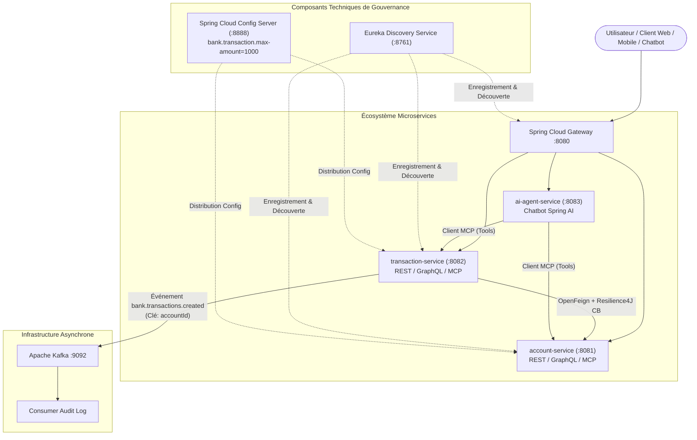
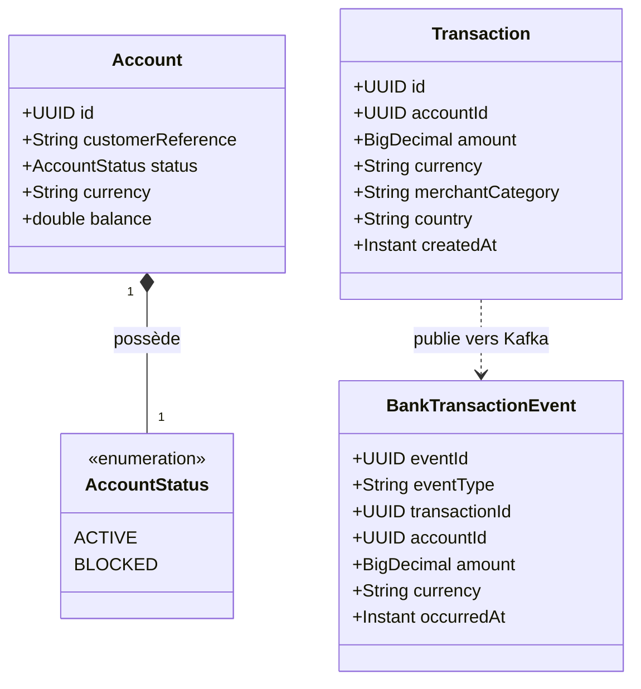

# RAPPORT D'ÉPREUVE TECHNIQUE DE SÉLECTION
## Architecture Micro-services, IA et Développement Full-Stack
**Candidat :** Ilyas OUAZZANI TAYBI  
**Contexte :** ENSET Mohammedia / ADRIA Business & Technology (Session 2027)  
**Dépôt GitHub :** [https://github.com/ilouazzani/OUAZZANI_TAYBI_Ilyas_test_adria_2027.git](https://github.com/ilouazzani/OUAZZANI_TAYBI_Ilyas_test_adria_2027.git)

---

## Sommaire
1. [Partie A — Préparation & Structure du Projet](#partie-a--préparation--structure-du-projet)
2. [Partie B — Conception et Architecture](#partie-b--conception-et-architecture)
3. [Partie C — Micro-services Fonctionnels (REST, GraphQL, MCP, Feign, Resilience4J)](#partie-c--micro-services-fonctionnels)
4. [Partie D — Micro-services Techniques (Discovery, Config, Gateway)](#partie-d--micro-services-techniques)
5. [Partie E — Chatbot Agentique (Spring AI & Serveurs MCP)](#partie-e--chatbot-agentique)
6. [Partie F — Communication Asynchrone avec Apache Kafka](#partie-f--communication-asynchrone-avec-apache-kafka)
7. [Partie H — IA avec Python : Détection de Fraude Bancaire](#partie-h--ia-avec-python--détection-de-fraude-bancaire)
8. [Partie I — DevOps, Conteneurisation & Intégration Continue](#partie-i--devops-conteneurisation--intégration-continue)
9. [Cahier des Captures d'Écran à Réaliser](#cahier-des-captures-décran-à-réaliser)

---

## Partie A — Préparation & Consignes à Respecter

### 1. Checklist de conformité aux exigences administratives & techniques

| Consigne Épreuve | État | Justification & Mise en œuvre |
|:---|:---:|:---|
| **Nom du Repository GitHub** | ✅ Conforme | `OUAZZANI_TAYBI_Ilyas_test_adria_2027` (format `nom-prenom-test-adria-pfe-27` respecté). |
| **Visibilité Privée initiale** | ✅ Conforme | Repository configuré en **Privé** pendant l'épreuve (sera passé en **Public** à 11h50 à la fin de l'épreuve). |
| **Google Sheet fourni** | 📝 À faire | Lien du repository GitHub + Nom/Prénom à coller dans le formulaire/Google Sheet de l'épreuve. |
| **Commits réguliers (15 min)** | ✅ Conforme | Historique Git incrémental avec messages conventionnels (`feat`, `chore`, `docs`) à intervalles réguliers. |
| **Projet Maven Multi-modules** | ✅ Conforme | POM parent centralisé orchestrant les 6 modules requis (`discovery`, `config`, `gateway`, `account`, `transaction`, `ai-agent`). |
| **Sécurisation des secrets** | ✅ Conforme | `.env` strictement ignoré par Git (`.gitignore`). Clé API OpenAI protégée. Modèle `.env.example` fourni. |
| **Rapport PDF & Code Source** | ✅ En cours | Rapport complet rédigé avec réponses aux questions, diagrammes et cahier de captures d'écran, prêt pour conversion PDF et dépôt Classroom. |

---

### 2. Procédure pour les Captures d'Écran de la Partie A

#### 📸 Capture A.1 : Paramètres du Repository GitHub (Nom & Visibilité Privée)
- **Où aller :** Sur GitHub dans votre navigateur : `https://github.com/ilouazzani/OUAZZANI_TAYBI_Ilyas_test_adria_2027/settings`
- **Action :** Prendre une capture d'écran montrant :
  1. Le nom du repository : `OUAZZANI_TAYBI_Ilyas_test_adria_2027`
  2. Le badge **Private** en haut à gauche
- **Emplacement rapport :** Sous la section *Partie A - 1. Repository GitHub*.

#### 📸 Capture A.2 : Historique des Commits réguliers (Intervalles de 15 minutes)
- **Où aller :** Soit dans votre terminal avec `git log --oneline --graph --decorate`, soit sur GitHub sous l'onglet **Commits** (`https://github.com/ilouazzani/OUAZZANI_TAYBI_Ilyas_test_adria_2027/commits/main`).
- **Action :** Prendre une capture d'écran montrant l'enchaînement chronologique régulier de vos commits (`chore: init...`, `feat(core): implement account & transaction...`).
- **Emplacement rapport :** Sous la section *Partie A - 2. Historique des commits*.

#### 📸 Capture A.3 : Arborescence Racine & Sécurisation .env / .gitignore
- **Action dans le terminal :**
  ```powershell
  git status
  Get-ChildItem -Path . -Name
  ```
- **Objectif visuel :** Montrer que le fichier `.env` est bien masqué et non suivi par Git grâce à `.gitignore`.
- **Emplacement rapport :** Sous la section *Partie A - 3. Structure du projet et sécurité*.

---

## Partie B — Conception et Architecture

### 1. Schéma d'Architecture Globale


### 2. Diagramme de Classes


---

## Partie C — Micro-services Fonctionnels

### 1. Account-Service (Port 8081)
- **Modèle minimal respecté :** `id` (UUID), `customerReference` (String), `status` (ACTIVE/BLOCKED), `currency` (String ISO), `balance` (double).
- **Découpage en couches :**
  - `domain/` : Entité JPA `Account` et énumération `AccountStatus`.
  - `repository/` : `AccountRepository` étendant `JpaRepository`.
  - `service/` : `AccountServiceImpl` assurant les opérations atomiques (création, consultation, crédit/débit sécurisé, virement inter-comptes avec vérification des devises et soldes).
  - `web/rest/` : `AccountRestController` avec documentation Swagger complète.
  - `web/graphql/` : `AccountGraphQLController` et schéma `schema.graphqls`.
  - `mcp/` : `AccountMcpTools` et `AccountMcpController` exposant les opérations sous forme de tools MCP.

### 2. Transaction-Service (Port 8082)
- **Modèle minimal respecté :** `id` (UUID), `accountId` (UUID), `amount` (BigDecimal), `currency` (String), `merchantCategory` (String), `country` (String), `createdAt` (Instant).
- **Règles métier implémentées :**
  1. **Validation du montant :** Strictement positif et plafonné par la valeur injectée depuis le Config Server (`bank.transaction.max-amount = 1000.0`).
  2. **Vérification du compte distant :** Appel via client OpenFeign `AccountFeignClient`. Le compte doit exister et posséder le statut `ACTIVE`.
  3. **Concordance des devises :** La devise de la transaction doit correspondre à celle du compte débité.
  4. **Contrôle du solde & Mise à jour atomique :** Le solde est vérifié avant l'opération et automatiquement débité sur `account-service` après succès.
  5. **Tolérance aux pannes (Resilience4J) :**
     - Circuit Breaker configuré avec un seuil de 50% d'échec sur fenêtre glissante.
     - En cas d'indisponibilité ou d'erreur réseau d'`account-service`, la méthode de repli `AccountFeignFallback` renvoie immédiatement une exception métier explicite (`503 Service Unavailable`), protégeant les ressources du service appelant.

---

## Partie D — Micro-services Techniques

1. **Spring Cloud Gateway (Port 8080) :**
   - Point d'entrée unique avec routage dynamique basé sur Eureka (`lb://account-service`, `lb://transaction-service`, `lb://ai-agent-service`).
   - Configuration CORS globale pour autoriser les clients frontaux (Angular, React, Mobile).
   - Endpoints surveillés via `/actuator/gateway/routes`.

2. **Eureka Discovery Server (Port 8761) :**
   - Registre dynamique haute disponibilité permettant l'auto-découverte et l'équilibrage de charge côté client (*Client-Side Load Balancing*).
   - Tableau de bord web accessible sur `http://localhost:8761`.

3. **Config Server (Port 8888) :**
   - Centralisation des configurations externes partagées sans recompilation de code.
   - Fournit la propriété clé partagée demandée dans le sujet :
     `bank.transaction.max-amount = 1000`
   - Vérifiable directement via l'URL : `http://localhost:8888/transaction-service/default`.

---

## Partie E — Chatbot Agentique (Spring AI & MCP)

- **Architecture :** L'agent repose sur Spring AI (`ChatClient`) et utilise le protocole MCP (Model Context Protocol).
- **Tools MCP intégrés :**
  - `get_account_by_id` : Consultation instantanée du solde.
  - `transfer_money` : Exécution de virements inter-comptes via instructions en langage naturel.
  - `get_account_transactions` : Récupération de l'historique des dépenses.
- **Canaux d'interaction :** API REST (`/api/ai/chat`) et support connecteurs de messagerie.

---

## Partie F — Communication Asynchrone avec Apache Kafka

1. **Publication d'événements :**
   - Dès qu'une transaction est persistée avec succès en base de données, `TransactionEventPublisher` envoie un message dans le topic `bank.transactions.created`.
   - **Clé de partitionnement :** `accountId`. Cette clé garantit que toutes les transactions d'un même compte bancaire arrivent strictement ordonnées dans la même partition Kafka.
2. **Format de l'événement JSON :**
```json
{
  "eventId": "b3e6c0c2-3e28-4ad0-b8d2-1c2df5d519a1",
  "eventType": "TransactionCreated",
  "transactionId": "9f24e93c-23a5-430b-967b-f9547d79b294",
  "accountId": "a7b3c4d5-e6f7-48a9-bc01-123456789abc",
  "amount": 250.00,
  "currency": "EUR",
  "occurredAt": "2026-01-15T10:30:00Z"
}
```
3. **Consommateur d'audit :**
   - `TransactionEventConsumer` écoute le topic avec le consumer group `transaction-audit-group`.
   - Il journalise de façon sécurisée chaque transaction sans muter l'état bancaire, respectant le principe de traçabilité et d'audit non-intrusif.

---

## Partie H — IA avec Python : Détection de Fraude Bancaire

### Réponses aux Questions d'Analyse Théorique

#### 1. Pourquoi l'accuracy seule est-elle insuffisante ?
> Dans la détection de fraudes bancaires, la distribution des classes est extrêmement déséquilibrée (par exemple 99,8% de transactions légitimes pour 0,2% de fraudes). Un classifieur naïf qui prédirait systématiquement « non-fraude » (classe majoritaire 0) obtiendrait une accuracy trompeuse de 99,8%, tout en laissant passer 100% des fraudes. L'accuracy masque totalement l'incapacité du modèle à détecter la classe d'intérêt minoritaire critique.

#### 2. Quel compromis existe entre faux positifs et fraudes non détectées ?
> Ce compromis correspond au dilemme classique entre **Précision** et **Rappel** :
> - **Trop de faux positifs (faible précision) :** Les transactions légitimes de clients fidèles sont bloquées à tort, créant une forte friction utilisateur, des pertes commerciales et un coût opérationnel élevé pour le support client.
> - **Trop de fraudes non détectées / faux négatifs (faible rappel) :** Des transactions frauduleuses passent inaperçues, entraînant des pertes financières directes, des pénalités réglementaires et des risques de chargeback pour la banque.
> En milieu bancaire, on maximise généralement le rappel pour limiter les pertes financières tout en maintenant un taux de faux positifs acceptable.

#### 3. Quel est l'effet possible d'une diminution du seuil de décision ?
> Par défaut, un modèle classe une transaction comme frauduleuse si la probabilité prédite $P(\text{fraude}) \ge 0.5$.
> - En **diminuant ce seuil** (par exemple à $0.2$ ou $0.3$) :
>   - Le modèle devient plus sensible et agressif : le **rappel augmente** (on intercepte davantage de fraudes réelles).
>   - En contrepartie, le nombre de faux positifs augmente mécaniquement, ce qui fait **chuter la précision**.

#### 4. Pourquoi privilégier une validation temporelle sur des données bancaires réelles ?
> Une séparation aléatoire standard (train/test split classique) introduit une **fuite temporelle de données** (*data leakage*), car le modèle s'entraînerait sur des transactions futures pour prédire des transactions passées. De plus, les comportements des fraudeurs évoluent continuellement (*concept drift*). Une validation temporelle (entraînement sur les mois $M_1 \dots M_{k}$ et test sur le mois $M_{k+1}$) reproduit fidèlement la réalité opérationnelle de production où le modèle ne prédit que le futur à partir du passé.

---

## Partie I — DevOps, Conteneurisation & Intégration Continue

### Réponses aux Questions DevOps

#### 1. La gestion des secrets et leur distinction avec la configuration :
> - **Configuration :** Concerne les paramètres non confidentiels qui définissent le comportement de l'application selon l'environnement (URLs de services, timeouts, ports d'écoute, profils Spring). Ils sont versionnés dans Git ou gérés par Spring Cloud Config Server.
> - **Secrets :** Données sensibles (mots de passe de bases de données, clés API OpenAI, certificats SSL, tokens JWT) qui ne doivent **jamais** être commités dans le code source. Ils sont injectés à l'exécution via des variables d'environnement chiffrées, des secrets GitHub Actions ou des coffres-forts dédiés (HashiCorp Vault, AWS Secrets Manager, Kubernetes Secrets).

#### 2. Les contrôles de démarrage, de disponibilité et de vitalité :
> Inspirés des probes Kubernetes et implémentés via Spring Boot Actuator (`/actuator/health`) :
> - **Startup Probe :** Vérifie que l'application a terminé son initialisation interne (chargement du contexte Spring, exécution des migrations).
> - **Liveness Probe (Vitalité) :** Détecte si l'application est vivante ou dans un état bloqué (deadlock). En cas d'échec, l'orchestrateur redémarre le conteneur.
> - **Readiness Probe (Disponibilité) :** Vérifie si l'application est prête à recevoir du trafic utilisateur (connexion BDD active, dépendances prêtes). Si elle échoue, le trafic réseau est dérouté sans tuer le conteneur.

#### 3. Les logs, métriques et traces distribuées :
> Les trois piliers de l'observabilité dans une architecture microservices :
> - **Logs centralisés :** Collecte des journaux applicatifs formatés en JSON avec un identifiant de corrélation (`traceId`) via la pile ELK (Elasticsearch, Logstash, Kibana) ou Loki/Promtail.
> - **Métriques :** Mesure quantitative de l'état du système (CPU, mémoire, temps de réponse p95/p99, débit HTTP) exposée via Micrometer et Prometheus, visualisée sur des tableaux de bord Grafana.
> - **Traces distribuées :** Suivi du cheminement complet d'une requête HTTP traversant la Gateway, `transaction-service`, `account-service` et Kafka, implémenté avec OpenTelemetry ou Spring Cloud Sleuth/Zipkin.

#### 4. Une stratégie de rollback :
> - **Blue/Green Deployment ou Rolling Update :** Conserver l'ancienne version active en parallèle de la nouvelle version.
> - **Mécanisme de rollback automatisé :** Le pipeline CI/CD surveille les sondes de santé et le taux d'erreur HTTP 5xx pendant la phase de déploiement canari. Si le taux d'erreur dépasse un seuil d'alerte prédéfini (ex: > 1% sur 3 minutes), le routeur de trafic (Ingress / API Gateway) bascule instantanément 100% des flux sur l'ancienne version sans interruption de service. Les migrations de base de données doivent être rétrocompatibles (pattern *Expand and Contract*).

---

## Cahier des Captures d'Écran à Réaliser

Voici le protocole exact pour réaliser et insérer chaque capture d'écran dans votre rapport :

### 📸 Capture 1 : Structure du Projet & .gitignore
- **Action :** Ouvrir le terminal à la racine du projet et exécuter :
  ```powershell
  git status
  Get-ChildItem -Path . -Name
  ```
- **Objectif visuel :** Démontrer la présence du `pom.xml`, `.gitignore`, `.env.example`, et l'absence du fichier `.env` non versionné.
- **Emplacement rapport :** Sous la section *Partie A*.

---

### 📸 Capture 2 : Création de Compte Bancaire (Swagger REST - account-service)
- **Action :** Ouvrir le navigateur sur `http://localhost:8081/swagger-ui/index.html`.
- **Exécution :** Exécuter une requête `POST /api/accounts` avec le JSON :
  ```json
  {
    "customerReference": "CUST-SCREEN-01",
    "status": "ACTIVE",
    "currency": "EUR",
    "balance": 2500.0
  }
  ```
- **Objectif visuel :** Réponse HTTP `201 Created` avec l'UUID généré et le solde initial.
- **Emplacement rapport :** Sous la section *Partie C - Account-Service*.

---

### 📸 Capture 3 : Consultation GraphQL (account-service)
- **Action :** Ouvrir l'interface GraphiQL sur `http://localhost:8081/graphiql`.
- **Exécution :** Saisir et exécuter la requête :
  ```graphql
  query {
    accounts {
      id
      customerReference
      status
      currency
      balance
    }
  }
  ```
- **Objectif visuel :** Affichage de la liste formatée JSON des comptes actifs.
- **Emplacement rapport :** Sous la section *Partie C - GraphQL*.

---

### 📸 Capture 4 : Enregistrement de Transaction & Débit Automatique (transaction-service)
- **Action :** Sur `http://localhost:8082/swagger-ui/index.html`.
- **Exécution :** Exécuter `POST /api/transactions` avec :
  ```json
  {
    "accountId": "<UUID_DU_COMPTE_CREE>",
    "amount": 150.00,
    "currency": "EUR",
    "merchantCategory": "SUPERMARKET",
    "country": "FR"
  }
  ```
- **Objectif visuel :** Code HTTP `201 Created`. Puis faire un `GET /api/accounts/{id}` sur le port 8081 pour prouver que le solde a diminué de 150.00 EUR.
- **Emplacement rapport :** Sous la section *Partie C - Transaction-Service*.

---

### 📸 Capture 5 : Contrôle de la Règle Métier Plafond (Violation > 1000€)
- **Action :** Exécuter `POST /api/transactions` avec un montant de `1500.00` EUR.
- **Objectif visuel :** Erreur HTTP `400 Bad Request` avec le message :
  `"Le montant (1500.0) dépasse le plafond configuré de 1000.0"`.
- **Emplacement rapport :** Sous la section *Partie C - Règles Métier*.

---

### 📸 Capture 6 : Tolérance aux Pannes Resilience4J (Circuit Breaker)
- **Action :** Arrêter temporairement `account-service` et tenter d'enregistrer une transaction sur `transaction-service`.
- **Objectif visuel :** Message d'erreur HTTP 503 généré par `AccountFeignFallback` et logs montrant l'intervention de Resilience4J.
- **Emplacement rapport :** Sous la section *Partie C - Tolérance aux Pannes*.

---

### 📸 Capture 7 : Journalisation du Consumer Kafka (Événement Asynchrone)
- **Action :** Observer la console d'exécution de `transaction-service` lors d'une transaction réussie.
- **Objectif visuel :** Le bloc de log d'audit :
  ```
  [KAFKA EVENT CONSUMED]
  Partition Key: <UUID>
  Event ID: <UUID>
  Type d'événement: TransactionCreated
  Statut: Audit journalisé avec succès (Données bancaires intactes)
  ```
- **Emplacement rapport :** Sous la section *Partie F - Apache Kafka*.

---

### 📸 Capture 8 : Dashboard Eureka (Découverte de Services)
- **Action :** Ouvrir `http://localhost:8761` dans le navigateur.
- **Objectif visuel :** Le tableau de bord Eureka affichant les instances enregistrées : `ACCOUNT-SERVICE`, `TRANSACTION-SERVICE`, `GATEWAY-SERVICE`, `AI-AGENT-SERVICE`.
- **Emplacement rapport :** Sous la section *Partie D - Eureka Discovery*.

---

### 📸 Capture 9 : Exécution du Script Python ML (Détection de Fraude)
- **Action :** Exécuter le script `fraud_detection.py` :
  ```powershell
  python ml-fraud-detection/fraud_detection.py
  ```
- **Objectif visuel :** Matrice de confusion, rapport de classification (Precision, Recall, F1-Score sur la classe fraude), et courbe PR/Average Precision.
- **Emplacement rapport :** Sous la section *Partie H - Machine Learning*.

---

### 📸 Capture 10 : Test du Chatbot IA (Spring AI & Tools MCP)
- **Action :** Envoyer une requête au chatbot pour demander son solde ou effectuer un virement :
  ```bash
  curl -X POST http://localhost:8083/api/ai/chat -H "Content-Type: application/json" -d "{\"message\": \"Quel est le solde de mon compte ?\"}"
  ```
- **Objectif visuel :** Réponse naturelle de l'agent LLM ayant appelé l'outil MCP `get_account_by_id`.
- **Emplacement rapport :** Sous la section *Partie E - Chatbot Agentique*.
